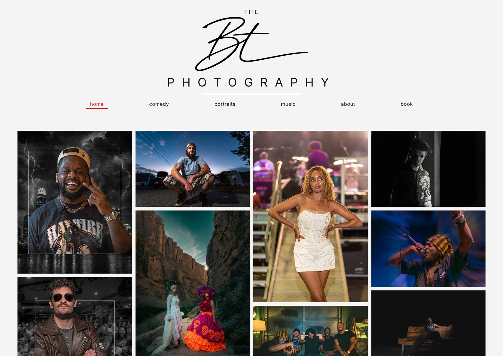

# BT Photography

My photography portfolio — a hand-built Next.js site for my work as a photographer in Austin, TX.

Live site: **[thebtphotography.com](https://thebtphotography.com)**



## Highlights

- **Scroll-driven carousels.** Sections of the mobile gallery pin to the viewport and advance photo by photo as you scroll, built on native CSS scroll timelines so the animation runs on the compositor instead of in JavaScript. Browsers without `animation-timeline` take a Framer Motion fallback driven by the same constants, so both paths show the same photo at the same scroll position. — [`components/MobileRail.tsx`](components/MobileRail.tsx)
- **Custom masonry layout.** Desktop packs four columns shortest-column-first so they end level; mobile composes a different sequence, with even runs of photos between carousels. The lightbox's prev/next order comes from the same walk that renders the grid, so it cannot drift from what is on screen. — [`lib/masonry.ts`](lib/masonry.ts)
- **Per-viewport image preloading.** One server-rendered document serves every screen, so `<Image preload>` can only aim at one layout's opening photo. Each layout's first photo is preloaded instead with media-scoped `<link>` tags built from `getImageProps`, and the generated widths are trimmed to the sizes phones actually request. — [`components/PortfolioSectionClassic.tsx`](components/PortfolioSectionClassic.tsx), [`next.config.ts`](next.config.ts)
- **Lightbox.** Arrow-key and Escape handling, labelled controls, drag-to-navigate with velocity thresholds, and a body scroll lock that restores the previous value on close. — [`components/Lightbox.tsx`](components/Lightbox.tsx)
- **Typed photo catalogue.** Every photo is a typed record carrying its dimensions, alt text, category and optional crop anchor. Layout code reads those records rather than measuring the DOM, which is what keeps the grid, carousels and lightbox in agreement. — [`lib/photos.ts`](lib/photos.ts)
- **Dynamic Open Graph image.** Generated with `next/og` from the site's own SVG wordmark, so link previews render from code rather than a checked-in PNG. — [`app/opengraph-image.tsx`](app/opengraph-image.tsx)

## Tech stack

Next.js 16.3 (App Router, static generation, built-in image optimization) · React 19.2 · TypeScript 5 · Tailwind CSS 4 · Framer Motion 13 · Formspree for booking submissions · deployed on Vercel.

## Accessibility and performance

- Alt text written for all 62 photographs — no empty or placeholder alt attributes in the gallery.
- Lightbox is fully keyboard operable: arrows navigate, Escape closes, and every control carries an `aria-label`.
- Carousel transitions check `prefers-reduced-motion` and move instantly rather than animating when it is set.
- Every image declares its intrinsic dimensions, so space is reserved before the bytes arrive; measured cumulative layout shift is ~0.001 on the home and section pages.
- Photos lazy-load outside the first screen and are served as WebP at device-matched widths — opening the home page costs five images (~0.35 MB), not the whole gallery.
- Scroll restoration is manual, so reloading inside a pinned carousel returns to the top of the page instead of a half-finished animation.

## Project structure

```
app/            Routes: home, comedy, portraits, music, about, book,
                plus the root layout and the dynamic OG image
components/     Gallery sections, scroll carousels, lightbox, header,
                mobile menu, footer
lib/            Photo catalogue, layout algorithms (masonry, mobile
                ordering, carousel composition), shared hooks
public/photos/  The photographs — 62 images, ~57 MB, capped at 3840px
docs/           Layout notes and the screenshot above
```

## Running locally

```bash
npm install
npm run dev     # http://localhost:3000

npm run build   # production build
npm start       # serve the production build
```

---

Designed, built and maintained by me. More of my work: **[bentims.com](https://bentims.com)**
